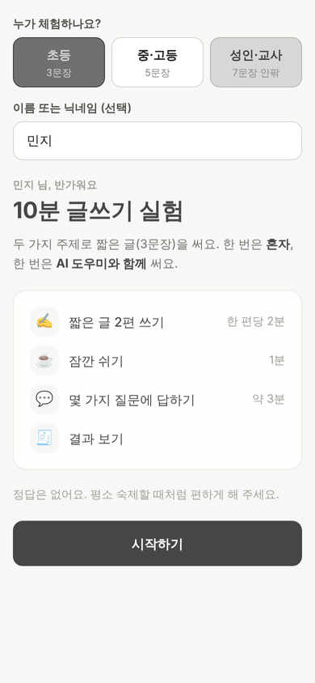
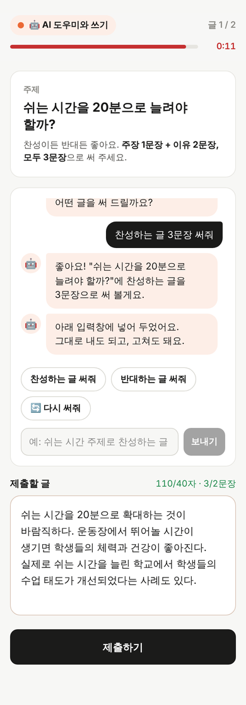
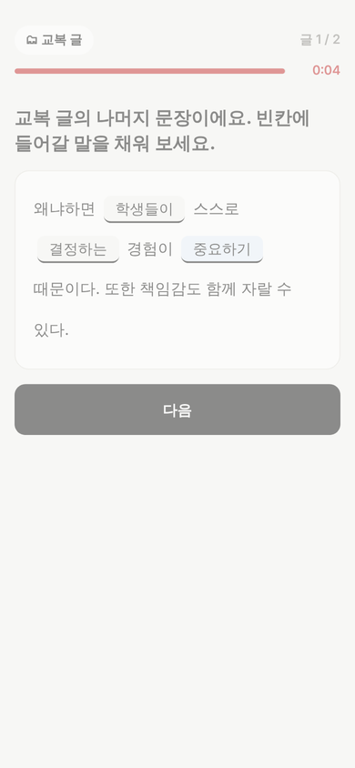
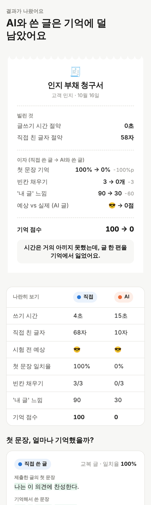
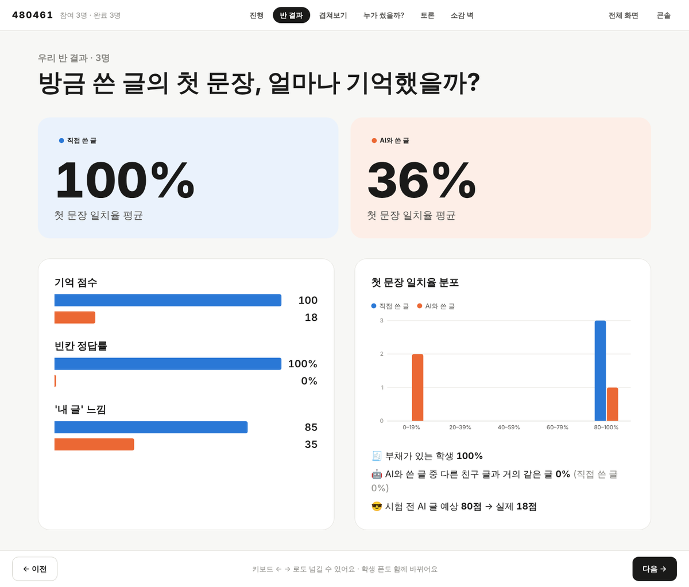
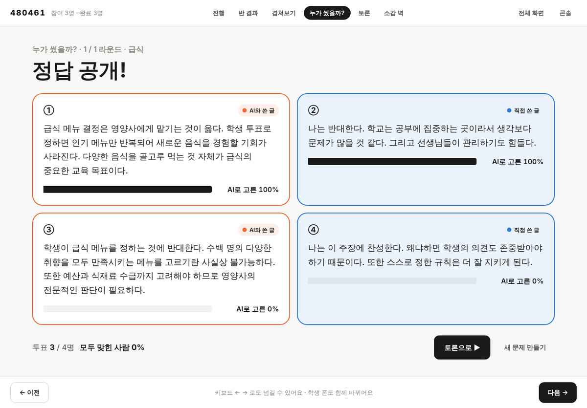
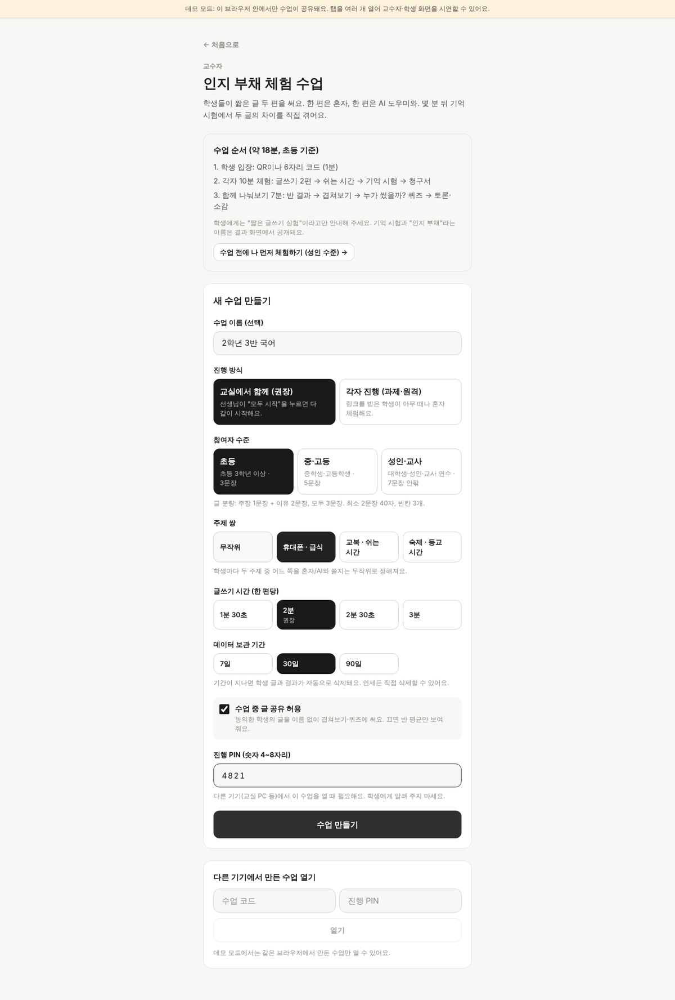
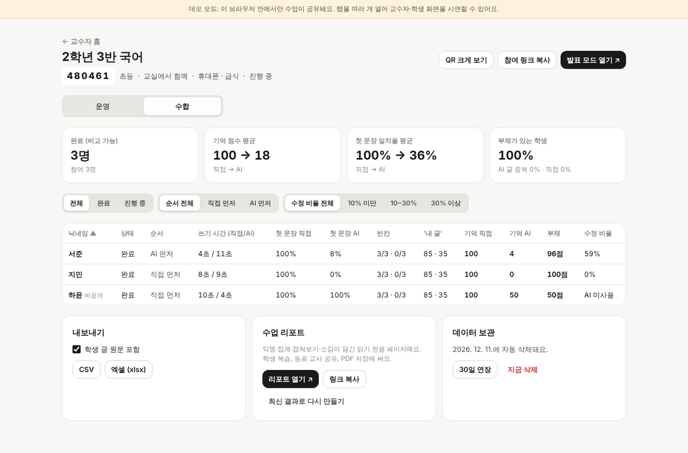

# braindebt · 10분 글쓰기 실험

인지 부채(Cognitive Debt)를 학생과 교사가 10~15분 안에 직접 겪어 보는 웹앱입니다.

참여자는 짧은 글 두 편을 씁니다. 한 편은 혼자, 한 편은 AI 도우미와 씁니다. 몇 분 뒤 글을 보지 않고 기억 시험을 치르면
"직접 쓴 글은 기억나는데 AI와 쓴 글은 안 난다"를 자기 숫자로 확인하고, 마지막에 **인지 부채 청구서**를 받습니다.
교수자는 수업을 만들어 진행을 관리하고, 결과를 모으고, 큰 화면에서 반 전체와 함께 나눠 봅니다.

- **바로 체험하기:** https://braindebt-zeta.vercel.app/#/solo
- **교수자로 수업 만들기:** https://braindebt-zeta.vercel.app/#/teach
- **처음 구상안:** [docs/concept.md](docs/concept.md)

## 화면 미리보기

| 수준 고르기 | AI 도우미와 쓰기 | 기억 시험 | 인지 부채 청구서 |
|---|---|---|---|
|  |  |  |  |

| 발표 화면: 반 결과 | 발표 화면: 누가 썼을까? 퀴즈 |
|---|---|
|  |  |

| 교수자: 수업 만들기 | 교수자: 결과 수합 |
|---|---|
|  |  |

## 어떻게 진행되나

**참여자 한 명의 체험 (10~15분)**
1. 글쓰기 두 편: 한 편은 혼자, 한 편은 AI 도우미와. 어느 주제를 어느 방식으로 쓸지는 무작위입니다.
2. 쉬는 시간 1분: AI 사용 습관 설문과 계산 문제. 실제 목적은 방금 쓴 글을 바로 떠올리지 못하게 하는 것입니다.
3. 기억 시험: 글마다 시험 전 예상, 첫 문장 떠올려 쓰기, 빈칸 채우기, "내 글" 느낌을 묻습니다.
4. 인지 부채 청구서: 두 글의 기억 점수를 나란히 보여 주고, 이 실험의 이름과 "AI와 쓰더라도 내 글로 남기는 법"을 공개합니다.

**수업에서 함께 나눠보기 (약 7분)**
교수자가 발표 화면을 넘기면 학생 폰도 같이 바뀝니다. 반 결과, 기억 겹쳐보기, "누가 썼을까?" 퀴즈, 토론, 익명 소감 벽 순서이고,
마지막에 이름을 뺀 수업 리포트 링크를 만들 수 있습니다.

## 참여자 수준

혼자 체험하기 화면과 교수자의 수업 만들기 화면에서 수준을 고릅니다. 수준에 따라 글 분량, 쓰기 시간, AI 초안 길이, 시험 시간, 빈칸 수가 함께 달라집니다.

| 수준 | 글 형식 | 제출 최소 | 쓰기 시간(기본) | AI 초안 | 빈칸 | 전체 체험 |
|---|---|---|---|---|---|---|
| 초등 (3학년 이상) | 주장 + 이유 2, 3문장 | 2문장 40자 | 2분 | 3문장, 60~130자 | 3개 | 약 10분 |
| 중·고등 | 주장 + 이유 2와 근거 + 맺음, 5문장 안팎 | 4문장 120자 | 3분 | 5문장, 170~280자 | 4개 | 약 12분 |
| 성인·교사 | 주장, 이유와 근거, 반론과 재반박, 맺음, 7문장 안팎 | 5문장 220자 | 4분 | 7문장, 300~450자 | 5개 | 약 15분 |

## 내 컴퓨터에서 실행하기

[Node.js](https://nodejs.org) 22 이상이 필요합니다.

```bash
git clone https://github.com/7guwol7-max/braindebt.git
cd braindebt
npm install
npm run dev        # http://localhost:5173
```

설정 없이 실행하면 **데모 모드**입니다. 수업 데이터가 브라우저에 저장되어, 같은 브라우저의 탭 여러 개로 교수자 화면과 학생 화면을 시연할 수 있습니다.
주소 뒤에 `?speed=10`을 붙이면 모든 타이머가 10배 빨라져 리허설에 편합니다. 예: `http://localhost:5173/?speed=10#/solo`

## 나만의 서버로 배포하기 (따라 하기)

학생 폰과 교수자 PC처럼 서로 다른 기기로 수업하려면 공용 백엔드가 필요합니다. 무료 플랜인 Supabase(데이터베이스)와 Vercel(웹 호스팅)로 30분 안에 만들 수 있습니다.

**1. 저장소 복사하기**
- GitHub에서 이 저장소 오른쪽 위의 **Fork**를 눌러 내 계정으로 복사합니다.

**2. Supabase 데이터베이스 만들기**
1. https://supabase.com 에 가입하고 **New project**를 만듭니다. 리전은 사용자와 가까운 곳(한국이면 Seoul)을 고릅니다.
2. 프로젝트가 준비되면 왼쪽 메뉴의 **SQL Editor**를 엽니다.
3. 이 저장소의 [`supabase/migrations/20261015000000_braindebt.sql`](supabase/migrations/20261015000000_braindebt.sql) 내용을 통째로 붙여 넣고 **Run**을 누릅니다. "Success"가 나오면 끝입니다.
4. **Project Settings → API**(또는 상단 **Connect**)에서 두 값을 복사해 둡니다.
   - Project URL: `https://xxxx.supabase.co`
   - Publishable key: `sb_publishable_...` (예전 프로젝트라면 anon key)
   - `service_role`이나 secret 키는 절대 쓰지 마세요. 앱에는 공개 키만 필요합니다.

**3. Vercel에 배포하기**
1. https://vercel.com/new 에서 GitHub로 로그인하고, Fork한 `braindebt` 저장소를 **Import** 합니다.
2. **Environment Variables**에 아래 값을 넣습니다. 빌드 설정은 `vercel.json`이 채워 주니 건드리지 않아도 됩니다.

   | 이름 | 값 |
   |---|---|
   | `VITE_SUPABASE_URL` | 2-4에서 복사한 Project URL |
   | `VITE_SUPABASE_ANON_KEY` | 2-4에서 복사한 Publishable key |

3. **Deploy**를 누릅니다. 빌드 로그에 `[braindebt] 백엔드: Supabase (...)`가 찍히면 연결된 것입니다. `데모 모드`라고 나오면 환경 변수를 다시 확인하고 재배포하세요.

**4. 로그인 없이 열리게 하기 (중요)**
Vercel은 새 프로젝트에 "Vercel Authentication" 보호를 기본으로 켭니다. 이대로면 학생이 링크를 열 때 Vercel 로그인을 요구합니다.
- 프로젝트의 **Settings → Deployment Protection → Vercel Authentication**을 **Disabled**로 바꾸고 저장합니다.

**5. 학생용 링크 주소 고정하기 (권장)**
- 배포가 끝나면 **Settings → Domains**에 보이는 기본 주소(예: `https://내프로젝트.vercel.app`)를 확인합니다.
- 환경 변수 `VITE_PUBLIC_URL`에 그 주소를 넣고 **Redeploy** 합니다.
- 이렇게 하면 교수자가 어떤 주소로 접속해 있든, 학생용 QR과 참여 링크는 항상 이 주소로 나갑니다.

**6. 확인하기**
- 로그인하지 않은 폰이나 시크릿 창에서 `https://내주소/#/teach`로 수업을 만들고, 다른 폰에서 QR로 참여해 봅니다.

내 컴퓨터에서 실제 백엔드로 실행하려면 `.env.example`을 `.env.local`로 복사해 같은 값을 넣고 `npm run dev`를 실행하면 됩니다.

## 바꿔 쓰기

| 바꾸고 싶은 것 | 파일 |
|---|---|
| 수준별 분량·시간·빈칸 수 | [`src/lib/levels.ts`](src/lib/levels.ts) |
| 주제 쌍, 초등 AI 초안, 설문 문항 | [`src/lib/content.ts`](src/lib/content.ts) |
| 중·고등, 성인 AI 초안 | [`src/lib/drafts-long.ts`](src/lib/drafts-long.ts) |
| 청구서·결과 화면 문구 | [`src/screens/BillScreen.tsx`](src/screens/BillScreen.tsx) |
| 토론 질문 | [`src/lib/share.ts`](src/lib/share.ts) |

AI 도우미는 실제 언어 모델 대신 미리 써 둔 초안을 돌려줍니다. 주제·수준·입장마다 3편씩입니다.
지연·비용·네트워크 문제가 없고 반 전체가 같은 품질의 글을 받습니다. 초안 수가 적어 반 안에서 AI 글이 서로 닮게 되는데,
발표 화면의 "다른 친구 글과 거의 같은 글" 지표와 퀴즈가 이것을 토론 거리로 씁니다.
초안을 바꾼 뒤에는 `npm test`로 문장 수와 길이가 수준 기준에 맞는지 확인하세요.

## 화면 주소

| 주소 | 누가 | 하는 일 |
|---|---|---|
| `#/` | 모두 | 수업 코드로 참여 · 혼자 체험 · 교수자 메뉴 |
| `#/solo` | 누구나 | 혼자 체험 (서버 불필요). `#/solo/adult`처럼 수준을 지정할 수 있음 |
| `#/join/:code` | 학생 | 닉네임, 공개 동의, 참여 |
| `#/c/:code` | 학생 | 수업 중 체험 → 청구서 → "함께 보기" |
| `#/teach` | 교수자 | 수업 만들기, 내 수업 목록, 다른 기기에서 PIN으로 열기 |
| `#/t/:code` | 교수자 | **운영**(모두 시작, 일시 정지, 늦은 학생 넘기기, 퇴장) · **수합**(표, 학생 상세, CSV/엑셀, 리포트, 보관·삭제) |
| `#/t/:code/present` | 교수자 | **발표 모드**: 입장 QR → 진행 현황 → 반 결과 → 겹쳐보기 → 퀴즈 → 토론 → 소감 벽 |
| `#/r/:id` | 누구나 | 읽기 전용 수업 리포트 (익명, PDF 저장) |

## 측정하는 것

| 지표 | 계산 |
|---|---|
| 첫 문장 일치율 | 제출한 글의 첫 문장과 기억해 쓴 문장의 글자 2-gram 겹침(Dice), 0~100% |
| 빈칸 채우기 | 첫 문장을 뺀 나머지에서 긴 어절을 수준별 개수만큼 가림. 조사 차이는 정답 처리 |
| 기억 점수 | (첫 문장 일치율 + 빈칸 정답률) / 2 |
| 부채 | 직접 쓴 글 기억 점수 − AI 글 기억 점수. 10점 이상이면 부채로 표시 |
| '내 글' 느낌 | 0~100 슬라이더 |
| 자신감 착시 | 시험 전 예측(😟😐😎)과 실제 기억 점수의 차이 |
| AI 사용 방식 | 요청 문장, 다시 쓰기 횟수, 초안 대비 수정 비율, 초안을 읽은 시간 |

## 보안과 개인정보

- 테이블은 RLS로 잠그고 anon 권한을 회수했습니다. 모든 읽기·쓰기는 `bd_*` RPC 함수로만 합니다.
- 교수자는 수업을 만들 때 받은 토큰(또는 PIN 로그인으로 받은 토큰)으로, 학생은 참여할 때 받은 비밀값으로 인증합니다. 둘 다 해시로만 저장합니다.
- PIN을 5번 틀리면 5분 동안 잠깁니다. 이미 로그인한 교수자 기기는 영향을 받지 않습니다.
- 실시간은 Supabase Broadcast로 "바뀌었어요" 신호만 보냅니다. 데이터는 항상 권한 검사를 거치는 RPC로 다시 읽습니다.
- 학생 글은 교수자와 본인만 봅니다. 발표 화면·리포트에는 공개에 동의한 글만 이름 없이 나옵니다.
- 보관 기간(기본 30일)이 지나면 수업 데이터가 삭제되고, 교수자는 언제든 즉시 삭제할 수 있습니다. 리포트는 익명 집계라 1년간 남습니다.

## 테스트

```bash
npm test                     # 단위 테스트 + 백엔드 계약 테스트(SQL을 PGlite에서 anon 역할로 실행)
npm run typecheck
npm run build
npm run e2e:solo            # dev 서버를 켠 뒤: 혼자 체험 전체 흐름 (Playwright, Chromium 필요)
npm run e2e:class           # dev 서버를 켠 뒤: 교수자 + 발표 + 학생 3명 수업 전체 흐름
```

백엔드 계약 테스트는 같은 수업 시나리오를 실제 SQL 마이그레이션과 브라우저 데모 백엔드 양쪽에 돌려,
두 백엔드가 같은 규칙과 같은 응답 모양을 갖는지 확인합니다.
브라우저 테스트는 `CHROME` 환경 변수로 Chromium 실행 파일 경로를 지정할 수 있습니다.

## 폴더 구조

```
src/
  pages/        화면(홈, 혼자 체험, 참여, 수업, 교수자 콘솔, 발표, 리포트)
  screens/      체험 단계별 화면(시작, 글쓰기, 쉬는 시간, 기억 시험, 청구서)
  flow/         체험 상태 기계(새로고침해도 이어짐)
  lib/          채점, 문장·빈칸 처리, 수준, 주제와 초안, 반 집계
  api/          백엔드 연결(Supabase, 브라우저 데모)
supabase/
  migrations/   데이터베이스 전체 설치 SQL
  manual/       자동 도구로 설치할 때 대시보드에서 따로 적용한 SQL
tests/          단위·계약 테스트와 브라우저 테스트
docs/           구상안과 화면 캡처
```

## 만든 방법

Claude Code와 대화하며 구상부터 배포까지 만들었습니다. 처음 구상과 그 변화 과정은 [docs/concept.md](docs/concept.md)에 있습니다.
